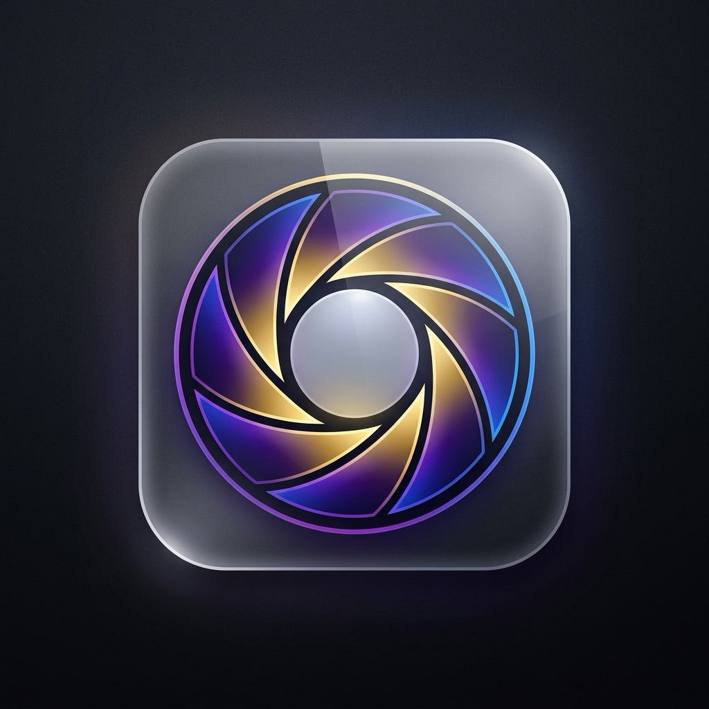

<p align="center">
  
</p>

<h1 align="center">HattyFocus</h1>

<p align="center">
  <strong>The Friendly, Private, Studio-Grade Photo Editor crafted by HattyHats</strong>
</p>

<p align="center">
  <a href="#key-features">Key Features</a> •
  <a href="#technology-stack">Tech Stack</a> •
  <a href="#getting-started">Getting Started</a> •
  <a href="#mobile-optimization">Mobile Support</a> •
  <a href="#privacy--offline-first">Privacy First</a>
</p>

---

**HattyFocus** is a client-side, browser-based photo editor created by **HattyHats**, designed to combine high-end creative tools with simple, responsive usability. It runs 100% locally on your machine, requiring no registration, remote servers, or internet connection after loading.

Whether you need a quick auto-enhance, pro color curves & 3-way wheels, curved vector typography, smart background removal, customized watermarks, or real-time P2P client proofing, HattyFocus provides an elegant workspace on both desktop and mobile screens.

---

## 🌟 Key Features

### 🎨 Non-Destructive Adjustment Layers, Curves & Presets
* **Precision Slider Suite**: Control Brightness, Contrast, Highlights, Shadows, Saturation, Warmth, Tint, Clarity, Sharpness, Vignette, Blur, Film Grain, and 3-Way Color Wheels.
* **RGB Tone Curves**: Per-layer spline tone mapping across Master RGB, Red, Green, and Blue channels.
* **⚡ Quick Fix & Presets**: One-tap auto-enhancement plus instant presets including *Golden Hour*, *Warm Film 1975*, *Cyberpunk Neon*, *Studio Portrait*, *Noir B&W*, and *Dramatic HDR*.

### ✂️ Smart Selectors & AI Background Removal
* **Magic Wand & Polygonal Lasso**: Select regions instantly based on color/alpha thresholds or freehand outlines.
* **AI Background Remover (BGR)**: One-click client-side neural background removal (RMBG-1.4 / MODNet with automatic offline geodesic fallback), connected-background Color Sample, Smart Matting Brush with Touch-Up restore, and live Edge Refine.
* **Selective Blur & Healing Brush**: Paint depth-of-field blur or spot-heal unwanted objects on canvas.

### 📝 Text, Stickers & Watermark Engines
* **Custom Text Layers**: Editable typography with custom fonts, letter weights, outlines, drop shadows, curved arc text paths, and free rotation.
* **Text Watermarks & Stickers**: Tile customizable copyright grids across your image or place rotated brand stamps and stickers.

### 📐 Non-Destructive Free Transform & Browser Memory Vault
* **Free Rotation, Crop, Resize, Frame & Flip**: Grab-and-turn free rotation (`-180°` to `+180°` with 15° snap) on the main photo, overlays, text, and watermarks, plus aspect-ratio crop, dimension scaling, decorative frames, and flips.
* **🕒 Recent Edits Vault**: Automatically remembers up to **10 recent edits** locally in your browser (via IndexedDB) so you can revisit and continue older projects anytime.

### 👥 Live P2P Collaboration & Proofing
* **Instant Room Sharing**: Share a room code or QR code for live cursors, vanishing laser pointers, pinned revision comments, star ratings, and View-Only or Co-Edit review sessions.

### 📊 Real-Time Tools
* **Live RGB Histogram**: Track luminance & color channels in real time.
* **Workspace History**: Complete Undo/Redo tracking and Command Palette (`Ctrl+K` / `/`).

---

## 📱 Mobile-First Optimization

HattyFocus is optimized for desktop, tablet, and mobile browsers:
* **Unified Pointer Events**: Unifies mouse, touch screen, and stylus interactions into one engine.
* **Multi-Touch Gestures**: Pinch-to-zoom and drag two fingers to pan around the canvas smoothly.
* **Overscroll Lock**: Uses viewport-level locks (`overscroll-behavior: none`) to prevent accidental pull-to-refresh or edge swipe navigation while editing.
* **Ergonomic Safe Zones**: Mobile controls respect bottom home-indicator safe zones.
* **Smart Memory Limits**: Automatically caps huge mobile camera photos at `2048px` on import (`3840px` on desktop) to keep editing smooth.

---

## 🛠 Technology Stack

HattyFocus is built to be lightweight, fast, and client-side:
* **Core Logic**: Pure Vanilla JavaScript (ES6+), HTML5 Canvas, and Context 2D APIs.
* **Styling**: Vanilla CSS3 with Custom Properties, multi-theme support, and glassmorphic UI styling.
* **Database**: Workspace auto-save and up to 10 recent projects stored locally via **IndexedDB** (`HattyFocusDB`).
* **Offline PWA Support**: Registered Service Worker (`sw.js`) and `manifest.json` configuration for offline capabilities and standalone home-screen installation.

---

## 🚀 Getting Started

Since HattyFocus is a client-side web application, running it locally is simple:

1. Clone or download this directory:
   ```bash
   git clone https://github.com/your-username/hatty-focus.git
   cd hatty-focus
   ```
2. Spin up a simple local HTTP server (recommended so Service Worker, Clipboard export, and browser storage run in a secure context):
   ```bash
   # Node / NPX
   npx serve .

   # Python 3
   python3 -m http.server 8000
   ```
3. Open `http://localhost:8000` (or the local URL provided) in your browser.

---

## 🛡 Privacy & Offline-First

Your data stays yours. HattyFocus performs image processing, pixel edits, project caching, and exports locally in your browser.
* **No Image Uploads**: Images are read and edited locally in your browser — nothing is uploaded to an application server.
* **Free & Ad-Supported**: Lightweight third-party ad placements help keep HattyFocus 100% free with zero sign-up or paywalls; ad scripts are loaded asynchronously with `referrerpolicy="no-referrer"` and never block offline editing.
* **IndexedDB Local Storage**: Autosave recovery and up to 10 recent edits remain inside your browser's local sandbox storage.
